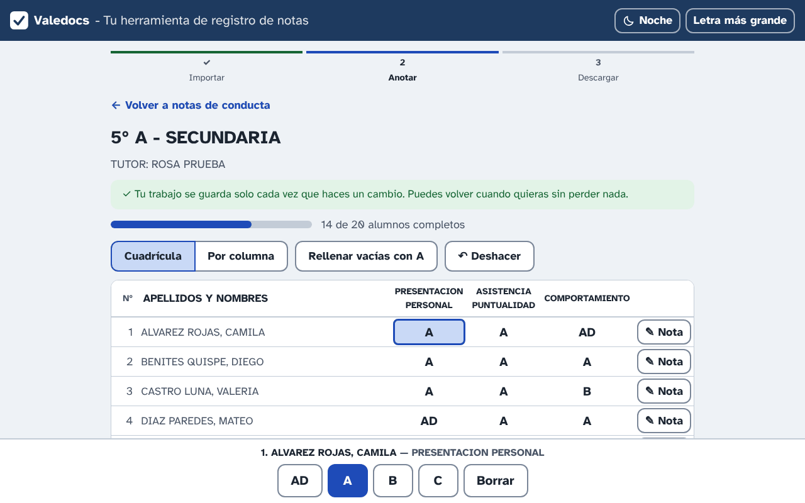
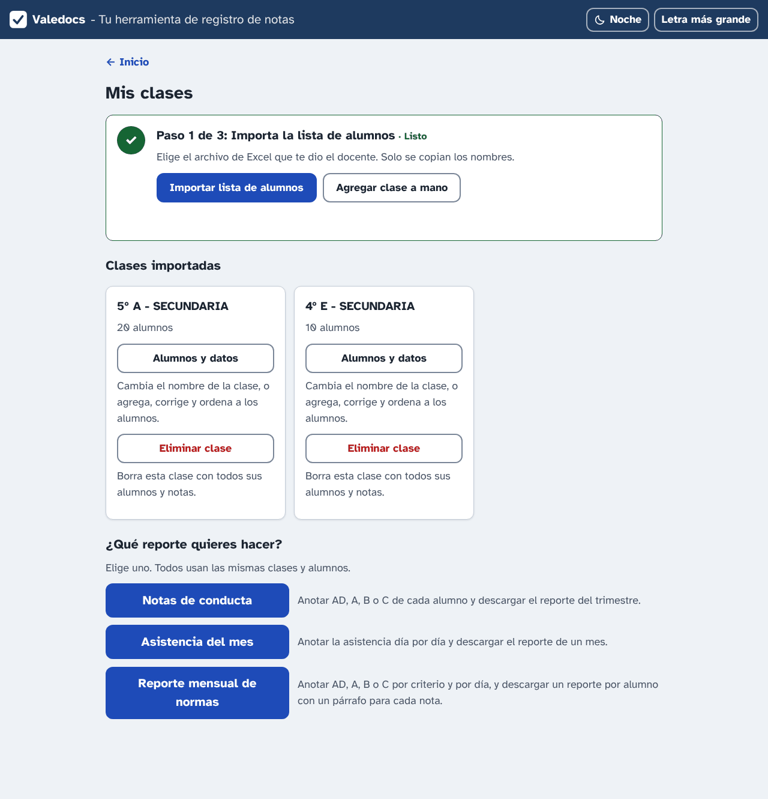
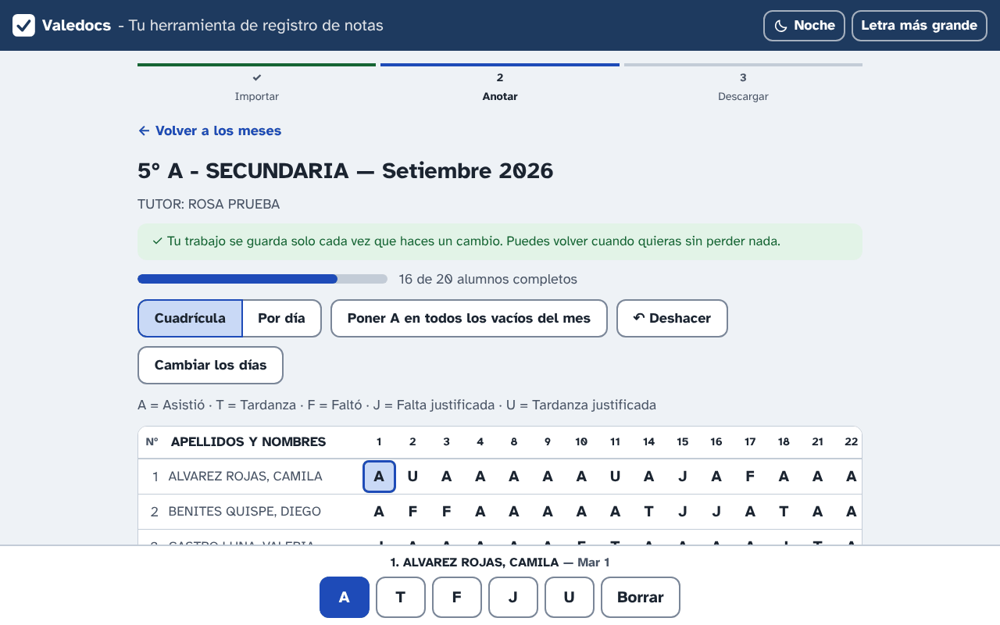
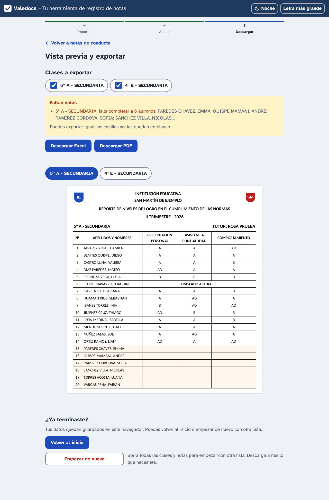
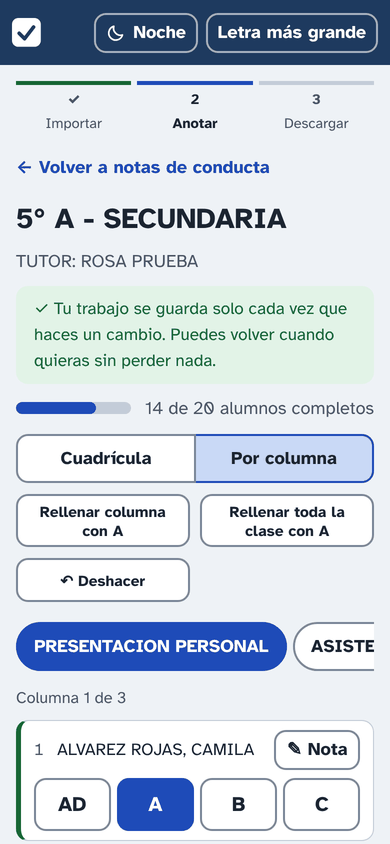
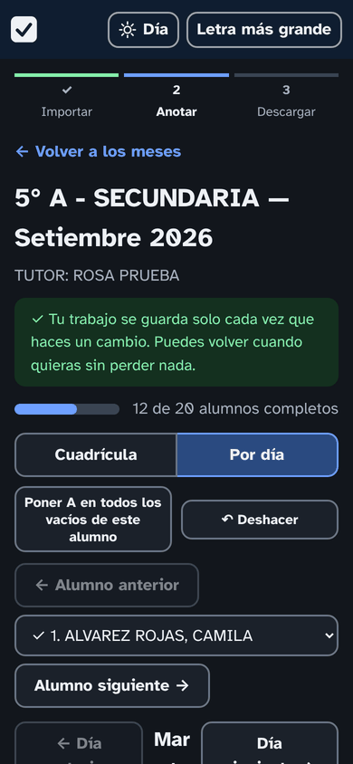
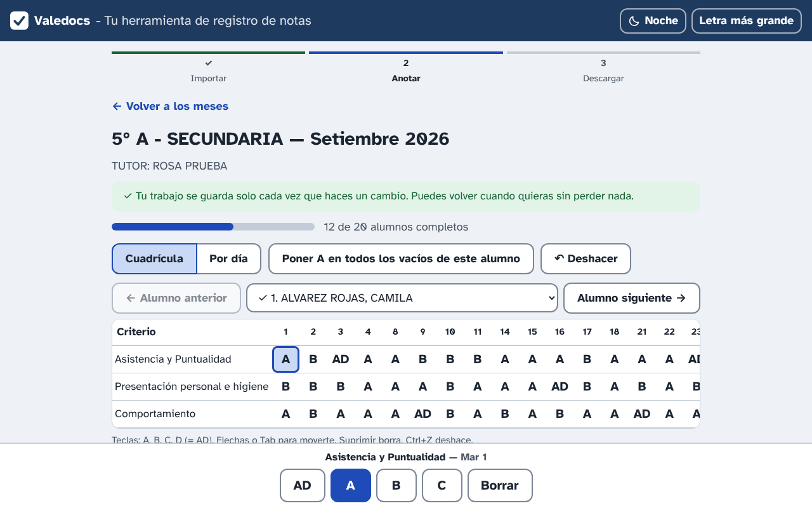

<h1 align="center">Valedocs</h1>

<p align="center">
  <strong>Registro de notas para docentes, sin instalar nada y sin subir datos a ningún lado.</strong><br>
  <em>Grade, attendance and norms reports for teachers: a web page that works offline and keeps every name in your browser.</em>
</p>

<p align="center">
  <a href="https://github.com/ctorres345/valedocs/actions/workflows/ci.yml"></a>
  <a href="https://github.com/ctorres345/valedocs/blob/main/LICENSE"></a>
  <a href="https://ko-fi.com/pandaveloper"></a>
</p>

<p align="center">
  <a href="#español">Español</a> · <a href="#english">English</a>
</p>

<p align="center">
  
</p>

---

## Español

Valedocs es una página web para registrar las notas de conducta, la asistencia mensual y el reporte mensual de
normas de una o varias clases, y descargar los reportes listos para entregar en **Excel, PDF o Word**. Está
pensada para docentes y auxiliares que reciben la lista de alumnos en un archivo de Excel y hoy llenan los
reportes a mano: botones grandes, una guía de 3 pasos por reporte, todo en español y sin mensajes técnicos.

**Úsala aquí:** https://valedocs.cjtech.dev (funciona en el celular y en la computadora; no hace falta cuenta).

### Qué hace

- 📥 **Importa la lista de alumnos** desde el Excel del docente, aunque pese mucho. Solo se copian los nombres
  (y las columnas de sexo y taller si existen); los dibujos invisibles que vuelven lento al archivo se ignoran.
- ✅ **Notas de conducta** por trimestre: `AD`, `A`, `B`, `C` en cada columna (presentación personal, asistencia
  y puntualidad, comportamiento, o las que configures). Se descargan en Excel o PDF con el encabezado y los
  logos de tu colegio.
- 📅 **Asistencia del mes**: una marca por día de clase (`A` asistió, `T` tardanza, `F` faltó, `J` falta
  justificada, `U` tardanza justificada) y el resumen en Observaciones. Un reporte por clase y mes, en Excel o
  PDF, y un **consolidado de faltas y tardanzas** de varios meses.
- 📝 **Reporte mensual de normas**: tres criterios calificados cada día; cada alumno recibe un documento en Word
  o PDF con un párrafo por nota (los párrafos se editan en los ajustes, con una redacción para él y otra para
  ella).
- 🖨️ **Hojas en blanco** para imprimir y anotar a mano durante el trimestre o el mes.
- 🔒 **Todo queda en tu navegador.** No hay cuentas ni servidor: los nombres y las notas se guardan en tu
  celular o computadora y en los archivos que descargas. Hay copia de seguridad y un "paquete del colegio" para
  llevar la configuración a otro equipo.
- 👓 Letra grande, modo noche, teclado en la computadora y botones grandes en el celular.

### Cómo se usa

Cada reporte tiene la misma guía de 3 pasos.

1. **Importa la lista de alumnos.** En _Mis clases_, elige el archivo de Excel del docente. Verás las clases que
   encontró; marca las tuyas. También puedes escribir una clase a mano.
2. **Anota.** Elige el reporte (conducta, asistencia o normas) y abre una clase. En la computadora escribes con
   el teclado (letras, flechas, Enter); en el celular tocas botones grandes, una columna o un día a la vez.
   Todo se guarda solo; puedes deshacer. Un alumno trasladado se marca con una **nota especial** que reemplaza
   sus notas.
3. **Revisa y descarga.** Mira la vista previa, y descarga el Excel, el PDF o el Word. Si falta algo, la página
   te dice qué y de quién.

La primera vez, entra a **Ajustes del reporte** y escribe el nombre de tu colegio, el trimestre y los logos (o
tómalos de un reporte anterior en Excel). Desde ahí puedes guardar un **paquete del colegio** y cargarlo en otro
celular o computadora.

<p align="center">
  
</p>

<p align="center">
  
</p>

<p align="center">
  
</p>

<p align="center">
  
  &nbsp;&nbsp;
  
</p>

### Tus datos

- Nada se envía a ningún servidor. La página se descarga una vez y después trabaja sola en tu navegador.
- Los datos viven en el navegador de **esa dirección y ese equipo**. Si cambias de celular o de navegador, lleva
  una **copia de seguridad** (botón en la página de inicio) y restáurala en el otro.
- Si configuras la exportación a Google Drive (opcional, ver abajo), el archivo se sube a **tu** Drive, con
  permiso solo sobre los archivos que crea Valedocs.
- Las notas de conducta y asistencia son datos personales de menores: trátalas con el cuidado que pide tu
  colegio y la ley de tu país. Valedocs no tiene acceso a ellas.

### Para programar

```bash
npm install
npm run dev      # http://localhost:5173
npm run check    # tipos, pruebas, formato y reglas de importación (antes de cada commit)
npm run build    # salida en dist/
```

Cómo está organizado el código: [docs/ARCHITECTURE.md](docs/ARCHITECTURE.md). Cómo se ve y las reglas de la
interfaz: [docs/DESIGN_SYSTEM.md](docs/DESIGN_SYSTEM.md). Cómo contribuir: [CONTRIBUTING.md](CONTRIBUTING.md).
El código y los comentarios están en inglés; solo lo que ve la usuaria está en español (todo en
`src/ui/texts.ts`).

### Apoya el proyecto

Valedocs es gratis y de código abierto, y lo va a seguir siendo. Si te sirve y quieres agradecer, puedes
invitarme un café en Ko-fi. Es totalmente opcional y se agradece mucho.

<p>
  <a href="https://ko-fi.com/pandaveloper"></a>
</p>

Contar un problema, proponer un reporte que te falta o pasarle la página a otra docente ayuda igual.

### Por qué hice esto

Hice esta aplicación principalmente para ayudar a mi madre. Ella es profesora, tiene más de 60 años y sigue
disfrutando de su profesión. Lo que a veces le resulta estresante es lidiar con el proceso de registro de notas:
a veces la laptop está lenta, a veces Excel deja de funcionar y pide renovar la licencia, y a veces le piden
hacer más y más reportes. Frente a este problema, quise aprovechar la oportunidad de armar un proyecto con Claude
que la ayude a aliviar un poco esa frustración. Así como a mi madre, espero que esta herramienta le sirva a
cualquiera que la necesite: si les hace la vida un poco más fácil, ya valió la pena.

— Cesar

---

## English

Valedocs is a web page for entering a class's **conduct grades**, **monthly attendance** and **monthly norms
report**, and downloading the reports ready to hand in as **Excel, PDF or Word**. It was made for teachers and
teaching assistants who get the student list as an Excel file and fill the reports in by hand today: big
buttons, a 3-step guide per report, plain Spanish, no technical messages. The UI is Spanish only (it was built
for schools in Peru); the code, comments and docs are English.

**Use it here:** https://valedocs.cjtech.dev (phone or computer, no account).

### What it does

- 📥 **Imports the student list** from the teacher's workbook, however heavy it is. Only the names (and the
  gender and workshop columns, if present) are copied; the invisible shapes that make such files slow are
  skipped.
- ✅ **Conduct grades** per term: `AD`, `A`, `B`, `C` in each column (personal presentation, attendance and
  punctuality, behaviour, or whatever you configure). Downloaded as Excel or PDF with your school's header and
  logos.
- 📅 **Monthly attendance**: one mark per school day (`A` present, `T` late, `F` absent, `J` excused absence,
  `U` excused lateness) and a summary column. One report per class and month, in Excel or PDF, plus a
  **consolidated absences and tardies** report over several months.
- 📝 **Monthly norms report**: three criteria graded every school day; each student gets a Word or PDF document
  that prints a paragraph for each grade (editable in the settings, with one wording for him and one for her).
- 🖨️ **Blank sheets** to print and fill in by hand during the term or month.
- 🔒 **Everything stays in your browser.** No accounts, no server: names and grades are kept on your phone or
  computer and in the files you download. There is a backup file and a "school pack" to carry the school's
  settings and logos to another device.
- 👓 Large text, night mode, keyboard entry on a computer and big buttons on a phone.

### How it works

Every report has the same 3-step guide: **import** the list (pick the classes found in the teacher's file, or
type one by hand), **enter** the data (keyboard grid on a computer, one column or day at a time with big buttons
on a phone, autosave and undo, a special note for a student who transferred), then **review and download** (a
preview, the Excel/PDF/Word button, and a list of what is still missing and for whom).

The first time, open **Ajustes del reporte** to type your school's name, the term and the logos (or take them
from a previous Excel report). From there you can save a **school pack** and load it on another device.

<p align="center">
  
</p>

### Your data

- Nothing is sent to a server. The page is downloaded once and then works on its own in your browser.
- Data lives in the browser of **that address and that device**. To move it, download a **backup** from the home
  page and restore it on the other one.
- The optional Google Drive export (below) uploads the file to **your** Drive, with permission over the files
  Valedocs creates only.
- Grades and attendance are personal data of minors: handle them as your school and your country's law require.
  Valedocs has no access to them.

### Tech stack

| Part    | Built with                                                                                                                                                                     |
| ------- | ------------------------------------------------------------------------------------------------------------------------------------------------------------------------------ |
| App     | [Vite](https://vitejs.dev) + TypeScript, no UI framework, hash routing. Data in IndexedDB through [idb-keyval](https://github.com/jakearchibald/idb-keyval).                   |
| Import  | Our own XML reader over [fflate](https://github.com/101arrowz/fflate), in a Web Worker, that skips drawings and media.                                                         |
| Export  | [ExcelJS](https://github.com/exceljs/exceljs) for Excel, [jsPDF](https://github.com/parallax/jsPDF) + AutoTable for PDF, hand-written OOXML (zipped with fflate) for Word.     |
| Drive   | Google Identity Services, `drive.file` scope, only when a client id is configured.                                                                                             |
| Look    | [Atkinson Hyperlegible](https://www.brailleinstitute.org/freefont/) (bundled, SIL OFL), day/night themes, large-text mode. See [docs/DESIGN_SYSTEM.md](docs/DESIGN_SYSTEM.md). |
| Quality | [Vitest](https://vitest.dev) on synthetic workbooks (no real file needed), TypeScript strict, Prettier, an import-rules check, GitHub Actions on Node 16 and 22.               |
| Hosting | Static files on Cloudflare Workers (`wrangler.jsonc`); every push to `main` redeploys.                                                                                         |

### Run it yourself

```bash
npm install
npm run dev      # http://localhost:5173
npm run check    # typecheck, tests, formatting and import rules (run before every commit)
npm run build    # output in dist/
```

How the code is organised: [docs/ARCHITECTURE.md](docs/ARCHITECTURE.md). How to contribute:
[CONTRIBUTING.md](CONTRIBUTING.md). Security reports: [SECURITY.md](SECURITY.md).

**Hosting your own copy.** The build is a folder of static files (`dist/`), so any static host works. For
Cloudflare: import the repo in Workers & Pages, build command `npm run build`, deploy command
`npx wrangler deploy`, and change the `routes` in `wrangler.jsonc` to your own domain (or remove them to use
the `*.workers.dev` address). `.node-version` pins Node 22 for the build.

**Google Drive button (optional).** It only appears when `VITE_GOOGLE_CLIENT_ID` is set. In the Google Cloud
Console create a project, enable the **Google Drive API**, configure the OAuth consent screen (External; add the
users' Gmail accounts as test users while the app is unverified) and create an **OAuth client ID** of type
_Web application_ with your site and `http://localhost:5173` as authorised JavaScript origins. Locally, copy
`.env.example` to `.env.local` and paste the id; on Cloudflare set it as a build variable. Only the `drive.file`
scope is requested.

**Bundled logos (optional).** A self-hosted build can ship a school's logos: put `left.png` and `right.png`
in `assets/logos/` and run `npm run logos`. The public build ships none; users add theirs in the settings.

### Support the project

Valedocs is free and open source, and it will stay that way. If it helps you and you'd like to say thanks, you
can buy me a coffee on Ko-fi. It's completely optional and very much appreciated.

<p>
  <a href="https://ko-fi.com/pandaveloper"></a>
</p>

Reporting a problem, suggesting a report your school needs, or telling a teacher about it helps just as much.

### Why I made this

I built this app mainly to help my mother. She is a teacher, over 60, and still enjoys her profession. What
sometimes stresses her is dealing with the grade registration process: sometimes the laptop is slow, sometimes
Excel stops working and asks to renew the licence, and sometimes she is asked to produce more and more reports.
Faced with that, I wanted to take the chance to build a project with Claude that could ease some of that
frustration. Just as it helps my mother, I hope this tool helps anyone who needs it: if it makes life a little
easier, it was worth it.

— Cesar

## License

Apache-2.0. See [LICENSE](LICENSE) and [NOTICE](NOTICE). Valedocs is not affiliated with any school, ministry
of education or Google.
